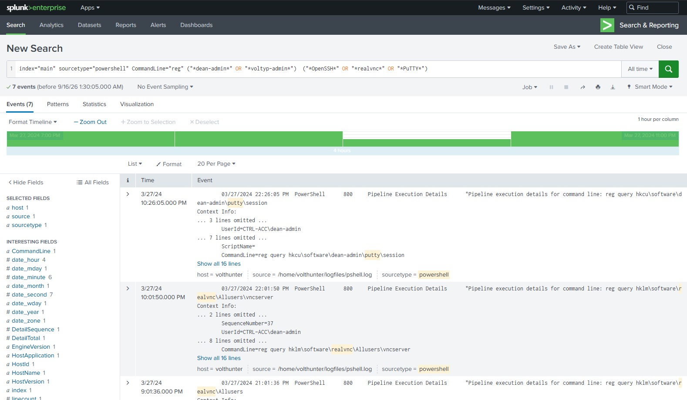

# 🧾 Write-up - Volt Typhoon 
### Este projeto foca em como investigar a sala Volt Typhoon da plataforma TryHackMe, utilizando consultas Splunk SPL, MITRE ATT&CK e pensamento analítico. 

### 🌪 Quem é Volt Typhoon? 

Segundo o MITRE ATT&CK, Volt Typhoon (G1017), é um ator patrocinado pelo Estado da República Popular da China (RPC) que está ativo desde pelo menos 2021, visando principalmente organizações de infraestrutura crítica nos EUA e seus territórios, incluindo Guam. O direcionamento e o padrão de comportamento do Volt Typhoon foram avaliados como pré-posicionamento para permitir o movimento lateral para ativos de tecnologia operacional (OT) para possíveis ataques destrutivos ou disruptivos. O Volt Typhoon enfatizou a furtividade nas operações usando web shells, binários living-off-the-land (LOTL), atividades práticas de teclado e credenciais roubadas.

#### O que é a técnica Living Off The Land?

É uma técnica de evasão de defesa, onde o atacante, após comprometer um sistema, utiliza binários e ferramentas legítimas do próprio sistema operacional para executar ações maliciosas, dificultando a detecção por antivírus e EDRs que confiam nessas ferramentas.

#### ⚙ Para a execução desse Write-up, foram utilizados apenas a sala Volt Typhoon da plataforma TryHackMe e o Splunk, que também é disponibilizado por eles na plataforma. Nesta sala, é preciso saber Splunk SPL (linguagem de consulta do Splunk) para podermos achar eventos suspeitos e então analisar os logs. Também é necessário utilizar o framework MITRE ATT&CK, para estudarmos o grupo e suas táticas, técnicas e procedimentos.

### 1. Scenario:

### 2. Initial Access

Active Directory Self Service é um serviço de autoatendimento para usuários de um domínio, usado para gerenciamento de senhas. Para esta primeira questão, vamos analisar os logs desse serviço, então o sourcetype na consulta será "adss". Como é dito na questão, o grupo Volt Typhoon geralmente obtém acesso inicial na rede explorando vulnerabilidades em software empresarial, e recentemente foi visto explorando o ADSelfService, a outra pista é que estamos procurando em qual momento a senha do usuário **dean** foi alterada e assumida pelo invasor.

Com essas informações em mãos, iremos fazer a seguinte consulta SPL: 
`index=* sourcetype="adss" username="*dean*" action_name="Password Change" | table timestamp username action_name status`

Obviamente, precisa ser feito um estudo prévio e uma análise do tipo de log que estamos lidando, para saber o que consultar.
Explicando rapidamente a consulta: estamos procurando o usuário **dean**, executando uma ação de troca de senha e organizando a saída em uma tabela com as colunas de tempo, usuário, nome da ação e o resultado da ação.

(`"*"` considera qualquer caractere que tenha no espaço onde se encontra, ou seja, busca o usuário **dean** mesmo se houver algum nome antes ou depois. 
`EX: admin-dean, dean-admin, user-dean-admin`) 

Podemos ver que a resposta da consulta gerou dois eventos com datas diferentes e com o mesmo usuário `dean-admin` (informação relevante na sala, nome completo do usuário comprometido). Entretanto, apenas um evento consta como status completed, e a data desse evento é a resposta `2024-03-24T11:10:22`. 

A outra questão quer o nome da nova conta de administrador, criada pouco tempo após o comprometimento do usuário dean-admin. 

A consulta: `index=* sourcetype="adss" action_name="Enrollment" | table timestamp username action_name status`

Explicando a consulta: estamos procurando uma ação de `Enrollment` (registro de novos usuários) e organizando a saída em uma tabela com as colunas de tempo, usuário, nome da ação e o resultado da ação.

A resposta da consulta gerou esse evento com o usuário `voltyp-admin`, o usuário administrador que foi criado.

### 3. Execution

### 4. Persistence

### 5. Defense Evasion

### 6. Credential Access

### 7. Discovery & Lateral Movement

### 8. Collection

### 9. C2 & Cleanup

